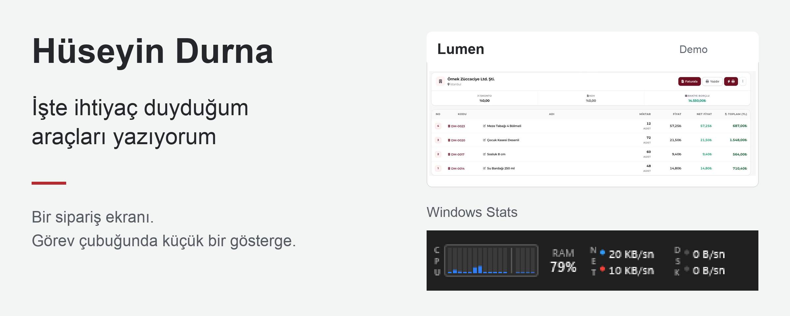

<picture>
  <source media="(max-width: 600px) and (prefers-color-scheme: dark)" srcset="assets/atelier/header-dark-mobile.png">
  <source media="(max-width: 600px)" srcset="assets/atelier/header-light-mobile.png">
  <source media="(prefers-color-scheme: dark)" srcset="assets/atelier/header-dark.png">
  <source media="(prefers-color-scheme: light)" srcset="assets/atelier/header-light.png">
  
</picture>

Aile şirketimiz [AKEL Melamin](https://akelmelamin.com)’de ön muhasebe ve IT işleriyle uğraşıyorum. Günlük işlerde ihtiyaç duyduğum araçları yazıyor, merak ettiğim şeyleri deneyerek öğreniyorum. Yazılım benim için hem bir hobi hem de işimi kolaylaştırmanın bir yolu. Yapay zekâ araçları da bu sürecin bir parçası.

**[Blog](https://blog.husodrn46.com)** · [Web sitem](https://husodrn46.com) · [E-posta](mailto:huseyindurna5@gmail.com)

## Seçilmiş projeler

### [Lumen](https://github.com/husodrn46/Lumen)

Sipariş, stok ve ön muhasebe işleri için mobil uyumlu bir web arayüzü. LOGO Tiger ile veya kendi veritabanıyla çalışıyor.

**Neden yaptım?** Günlük sipariş ve stok işlerini telefondan da halledebilmek için.

[Kurulum ve kullanım](https://github.com/husodrn46/Lumen#kurulum)

### [Windows Stats](https://github.com/husodrn46/windows-stats)

Windows görev çubuğunda işlemci, bellek, disk ve ağ kullanımını gösteren küçük bir araç. [winstats](https://github.com/mgvs/winstats) üzerine geliştirdiğim, Türkçe ve İngilizce arayüzü olan bir çatal.

**Neden yaptım?** Sistemin durumunu ayrı bir pencere açmadan, göz ucuyla görebilmek için.

[Son sürümü indir](https://github.com/husodrn46/windows-stats/releases/latest)

### [Kod Otağı](https://github.com/husodrn46/t3code-tr)

Yapay zekâ ajanlarıyla çalışmak için kullandığım t3-code’un Türkçe çatalı.

**Neden uğraşıyorum?** Kullandığım geliştirme ortamını Türkçeleştirmek ve kendi çalışma biçimime uyarlamak için.

[Depoyu incele](https://github.com/husodrn46/t3code-tr)

## Masa dışında

Raspberry Pi üzerinde kendi servislerimi kurmayı, cihazları birbirine bağlamayı ve otomasyonlarla uğraşmayı seviyorum. Astronomi, matematik ve tarihî mimari de merak ettiklerim arasında. Ara sıra [blogumda](https://blog.husodrn46.com) yazıyorum.
